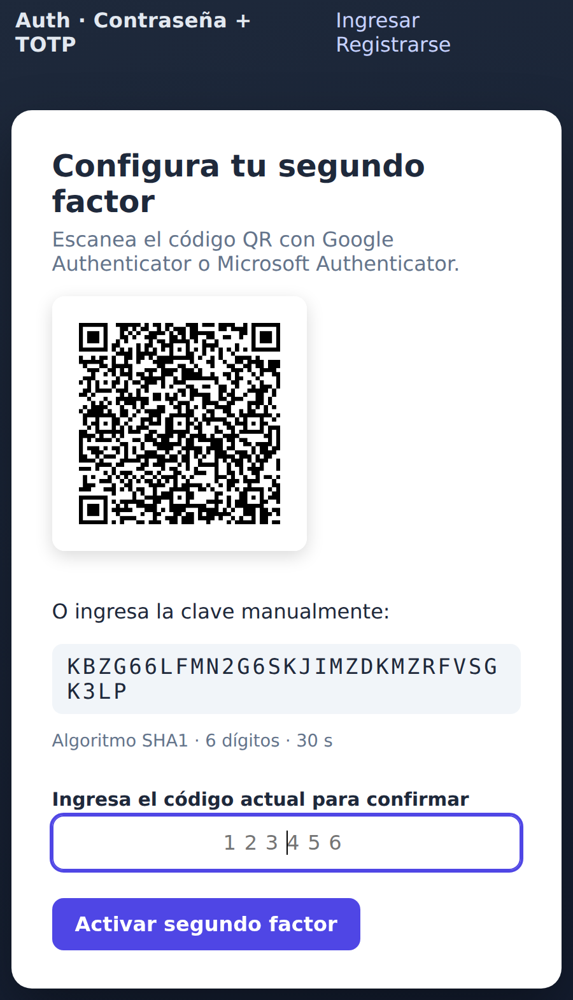

<!-- _class: lead -->

# Autenticación: contraseña + **TOTP**

## construida desde cero y **atacada por nosotros mismos**

**Miguel Ulloa Wood · Alexander Burgos Quezada**

IIC2531 — Seguridad Computacional · 2026

<!-- Hola, somos Miguel y Alexander. Nuestro proyecto es un sistema de autenticación de dos factores. La idea central: no solo construirlo, sino tratarlo como objeto de estudio de seguridad y medir si sus defensas realmente funcionan. -->

---

## El problema

- Las **contraseñas solas** son un factor débil: se reutilizan, se filtran, se phishean.
- **2FA**: aunque roben la contraseña, falta el segundo factor.
- **TOTP** es el 2FA más usado: solo un secreto + un reloj.
- Pero **implementarlo bien es sutil**: un detalle mal hecho rompe la garantía.

Implementamos un servidor web local que exige **contraseña + un código de 6 dígitos que cambia cada 30 s (TOTP)**. Lo distintivo: el algoritmo TOTP está implementado desde cero (no con una librería) y mediante IA atacamos a nuestro propio sistema y lo registramos.

<!-- Las contraseñas se filtran en brechas masivas y se reutilizan. El segundo factor mitiga esto. TOTP domina porque no necesita SMS ni hardware. El mensaje clave de la charla: que "funcione" no basta; los detalles deciden si resiste un ataque. -->

---

## Qué construimos (alcance)

- Servidor **Flask local** con login en **dos pasos**: contraseña + TOTP.
- **TOTP desde cero** (HMAC-SHA1, RFC 6238) — opera con Google/Microsoft Authenticator.
- Enrolamiento por **QR**, **códigos de respaldo**, panel.
- **Defensas**: cifrado del secreto, `compare_digest`, lockout, anti-replay, CSRF.
- **IA que simula un atacante**, ataca y mide nuestras propias defensas.


<!-- Construimos un servidor Flask con login en dos pasos. El núcleo TOTP está hecho a mano con la librería estándar para controlar cada paso. Lo novedoso, y lo que más pesa en un curso de seguridad, es el arnés que ataca nuestra propia implementación. -->

---

## Conexión con el curso

| Tema                   | Dónde aparece                                                                     |
| ---------------------- | --------------------------------------------------------------------------------- |
| Criptografía aplicada  | HMAC, bcrypt, cifrado autenticado                                                 |
| Autenticación          | login en dos pasos                                                                |
| Modelo de amenaza      | qué ataques estan dentro o fuera de alcance                                       |
| Canal lateral (timing) | `compare_digest`, segun la documentación, es la proteccion adecuada               |
| Defensa en profundidad | bloqueos de cuenta + limitar request por IP + seguridad contra replay             |
| Seguridad web          | Tokens CSRF, sesión, Protección contra inyeccion SQL por consultas parametrizadas |

<!-- El proyecto toca de forma transversal los temas del curso. No es solo cripto: es modelo de amenaza, canales laterales, defensa en profundidad y seguridad web. -->

---

## Decisiones de seguridad

| Riesgo                          | Defensa                                                   |
| ------------------------------- | --------------------------------------------------------- |
| Fuga del archivo `.db`          | bcrypt (contraseña) + secreto cifrado con AES y Hmac      |
| Fuerza bruta                    | Bloquear cuenta por intentos fallidos + limitación por IP |
| Ataques de timing               | `hmac.compare_digest`                                     |
| Replay de código                | último paso consumido                                     |
| Enumeración de usuarios         | mensaje uniforme + bcrypt señuelo si no existe usuario    |
| CSRF / Inyección SQL / fijación | token CSRF · queries parametrizadas · regen. sesión       |

## <!-- Esta tabla es el corazón técnico. Cada fila es una amenaza concreta con su defensa. En las próximas láminas mostramos evidencia medida de las cuatro más interesantes. -->

---

## Primera version (no final)

    def generate_totp(secret):
      key = base64.b32decode(secret, casefold=True)

      time_step = int(time.time() // 30)
      time_bytes = struct.pack('>Q', time_step)

      hmac_hash = hmac.new(key, time_bytes, hashlib.sha1).digest()
      offset = hmac_hash[-1] & 0x0F

      code = (hmac_hash[offset] << 24 | hmac_hash[offset + 1] << 16 |
            hmac_hash[offset + 2] << 8 | hmac_hash[offset + 3])
      totp_code = code % 1000000

      return str(totp_code).zfill(6)

    def compare_totp(secret, code):
      expected_code = generate_totp(secret)
      return hmac.compare_digest(expected_code, code)

---

## Modelo de amenaza


<!-- Definimos explícitamente el atacante: remoto, sin credenciales, que adivina, mide tiempos, reenvía peticiones y puede obtener una copia de la base de datos. A la izquierda lo mitigado; a la derecha el riesgo residual que dejamos fuera de alcance y que discutiremos al final. -->

---

## Arquitectura


<!-- Módulos con responsabilidades acotadas (privilegio mínimo y separación). El servidor coordina TOTP, crypto, rate-limiter y sesiones; la base de datos guarda hashes y el secreto cifrado. -->

---

## Cómo funciona TOTP


- `T = ⌊unix/30⌋` → `HMAC-SHA1(secreto, T)` → truncación dinámica → `mod 10⁶`
- El mismo secreto en el teléfono y en el servidor ⇒ mismo código.

<!-- TOTP es HOTP aplicado al tiempo. Se hace HMAC del secreto con el número de paso de 30 segundos, se trunca dinámicamente según el RFC 4226 y se toma módulo un millón. Como teléfono y servidor comparten secreto y reloj, generan el mismo código. -->

---

## Login en dos pasos


## <!-- El estado intermedio vive en el servidor: tras la contraseña la sesión queda "pendiente de 2FA"; solo al validar el TOTP se promueve a autenticada, regenerando la sesión. La verificación incluye ventana, anti-replay y comparación en tiempo constante. -->

## Demo

  

_Enrolamiento (QR) → verificación 2FA → sesión protegida_

<!-- Demostración: el usuario escanea el QR, la app genera códigos, ingresa el de 6 dígitos y entra. Si hay tiempo lo mostramos en vivo en localhost. -->

---

## Flujo de un login

Cuando alguien envía el formulario de contraseña a `/login`:

1. **`app.py`** (ruta `login`) recibe el POST. Primero, el guardia `csrf_protect`
   (un `before_request`) valida el **token CSRF**.
2. Llama a **`accounts.verify_password_step(...)`**:
   - Si el usuario **no existe**, igual ejecuta `crypto.dummy_verify()` (un bcrypt
     "señuelo") y devuelve el **mismo** mensaje genérico → no se nota si el usuario
     existe (anti-enumeración).
   - Revisa si la cuenta está **bloqueada** (`ratelimit.is_locked`).
   - Verifica la contraseña con **`crypto.verify_password`** (bcrypt).
   - Si falla, registra el fallo (`ratelimit.register_password_failure`, que puede
     disparar el bloqueo).

---

## Flujo de un login (continuación)

3. Si la contraseña es correcta, **`sessions.start_pending_2fa(uid)`** marca la sesión
   como _"contraseña OK, falta el 2FA"_ y redirige a `/2fa`. **Aún no estás logueado.**
4. En `/2fa` envías el código → **`accounts.verify_totp_step(...)`**:
   - Descifra el secreto con **`crypto.SecretVault`** y verifica con **`totp.verify`**
     (tolerancia ±1 paso de tiempo).
   - **Anti-replay**: el paso del código debe ser _mayor_ al último usado
     (`last_totp_counter`); si no, se rechaza.
   - Si no era un código TOTP, prueba si es un **código de respaldo**
     (`recovery.verify_and_consume`, de un solo uso).
5. Si todo bien, **`sessions.complete_login(uid)`** **regenera** la sesión y recién ahí
   fija `user_id` → estás autenticado (defensa contra _fijación de sesión_).

---

## Flujo de registro

El registro/enrolamiento sigue la misma lógica: `accounts.register` → `start_enrollment`
(genera y **cifra** el secreto) → `confirm_enrollment` (verifica el primer código,
activa el 2FA y crea los códigos de respaldo)

---

## Resultado E1 — Conformidad RFC


**16/16** vectores oficiales (RFC 4226 + RFC 6238) ⇒ correcto e **interoperable**.

<!-- Validamos contra los vectores de prueba oficiales de los RFC. 16 de 16 correctos. Esto prueba que el algoritmo es correcto y, por construcción, interoperable con cualquier app estándar. -->

---

## Resultado E3 — Canal lateral por tiempo


Comparación ingenua: **+16 ns/carácter** correcto (fuga). `compare_digest`: **plana**.

<!-- Medimos el tiempo de comparación según cuántos caracteres iniciales aciertan. La comparación ingenua sube linealmente: esa pendiente es la fuga que permite adivinar carácter a carácter. compare_digest es plana. Honestidad: amplificamos con un token de 32 caracteres para verlo; el principio vale igual. -->

---

## Resultado E4 — Fuerza bruta vs. lockout

| Escenario      | Intentos/h |  Tiempo a 50% |
| -------------- | ---------: | ------------: |
| Sin protección |    180.000 |     ~0,1 días |
| Throttle IP    |      1.200 |       ~8 días |
| **Lockout**    |     **12** | **~802 días** |


<!-- Un código de 6 dígitos tiene un millón de valores. Lo decisivo es cuántos intentos por hora se permiten. El lockout baja de 180 mil a 12 intentos por hora: el tiempo esperado de un ataque exitoso pasa de horas a más de dos años. Cuatro órdenes de magnitud. -->

---

## Resultado E5 + E6

**E5 — Replay**

```
[1] login con código 495104  -> ok
[2] MISMO código (misma ventana) -> RECHAZADO (replay)
```

**E6 — Pruebas:** `33 passed` (vectores RFC, lockout, replay, backup, cifrado, CSRF…)

<!-- El replay: un código vale una vez; reusarlo en su ventana se rechaza por el registro del último paso consumido. Y las 33 pruebas automatizadas pasan, cubriendo desde los vectores RFC hasta CSRF. -->

---

## Limitaciones y riesgo residual

- **TOTP es phishable**: Por naturaleza.
- **El primer mensaje es interceptable**: Un MitM puede interceptar en el enroll. Vulnerabilidad natural de TOTP.
- **Sin HTTPS** en demo local;(un proceso).
- **Ignoramos ataques de frontend**, no usamos un framework por simplicidad, y porque nuestro proyecto era de backend (el frontend es para testear).
- **Ataques distribuidos**: Restringimos requests por IP, ademas el bloqueo es por cada cuenta
- Ninguna 2FA protege un **endpoint comprometido**.

<!-- Somos honestos sobre los límites. TOTP no resiste phishing en tiempo real; la defensa real es WebAuthn. La seguridad del secreto cifrado depende de proteger la clave maestra. Y nada protege un dispositivo con malware. -->

---

## Aprendizajes

Como funciona algoritmo TOTP por detrás.

Implementacion de defensas contra ataques generales: Fuerza bruta (Limitacion por IP y bloqueo de cuenta), consultas parametrizadas para inyección SQL, tokens CSRF, proteccion contra replay.

Defensas específicas de TOTP: comparación en tiempo constante, cifrado del secreto, anti-replay.

Implementación de servidor web en Flask, y uso de SQLite.

<!-- El gran aprendizaje: la dificultad está en los detalles que deciden si resiste un ataque. Distinguir hashing de cifrado. Y sobre todo, que medir una defensa es muy distinto de suponer que funciona. -->

---

<!-- _class: lead -->

# ¿Preguntas?

**Gracias.**

_Código, informe y experimentos reproducibles con_ `make all`

<!-- Gracias. Todo es reproducible con make all. Quedamos atentos a sus preguntas. -->
