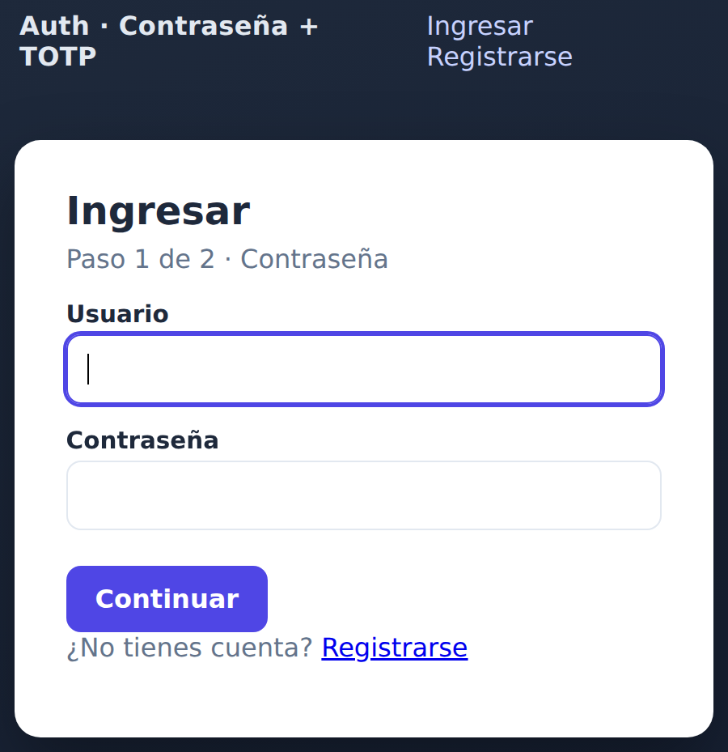
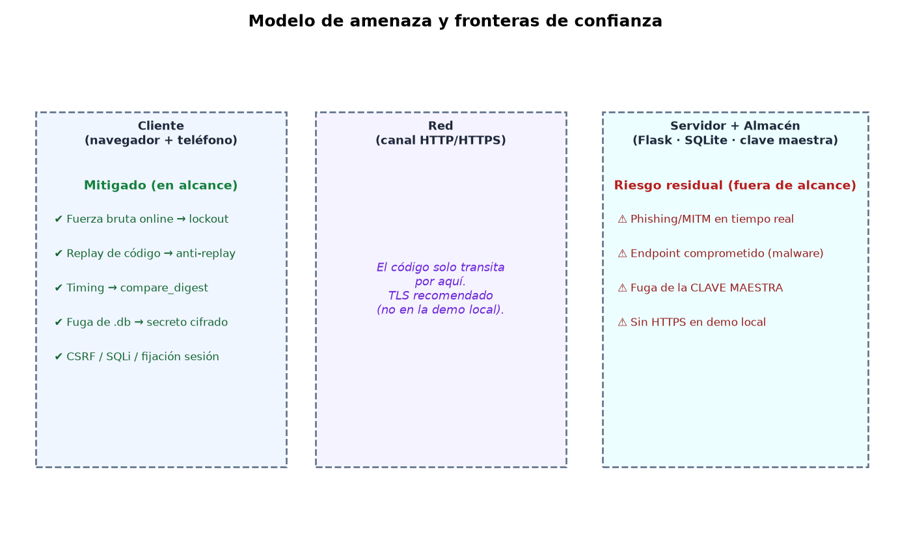
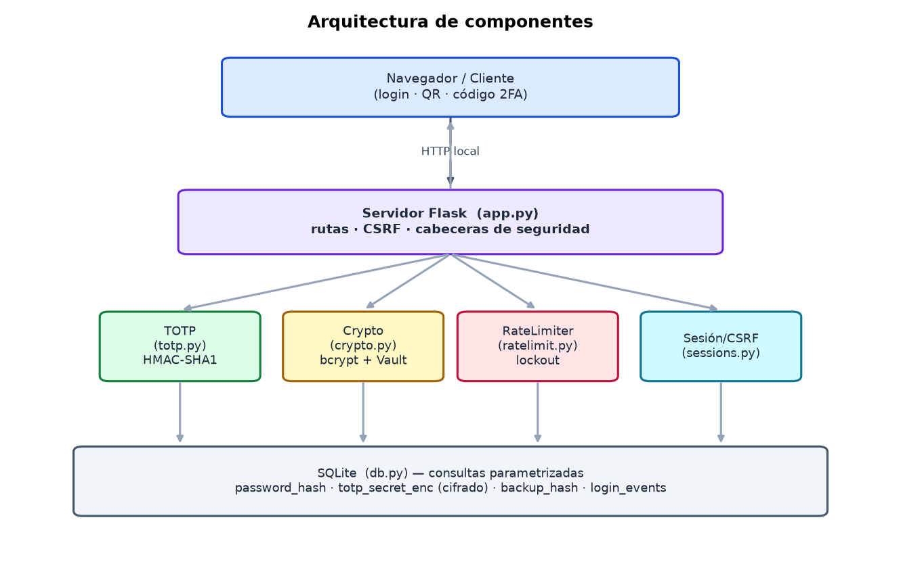
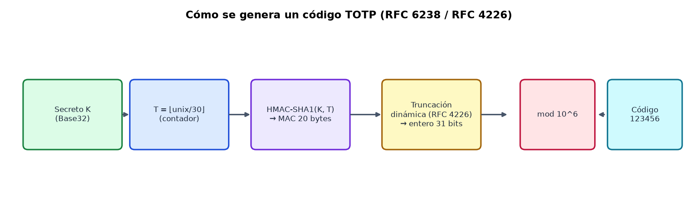
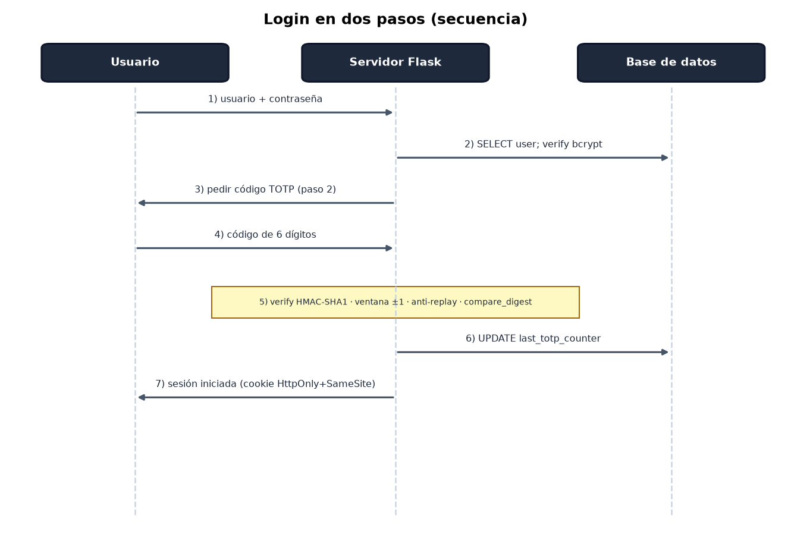
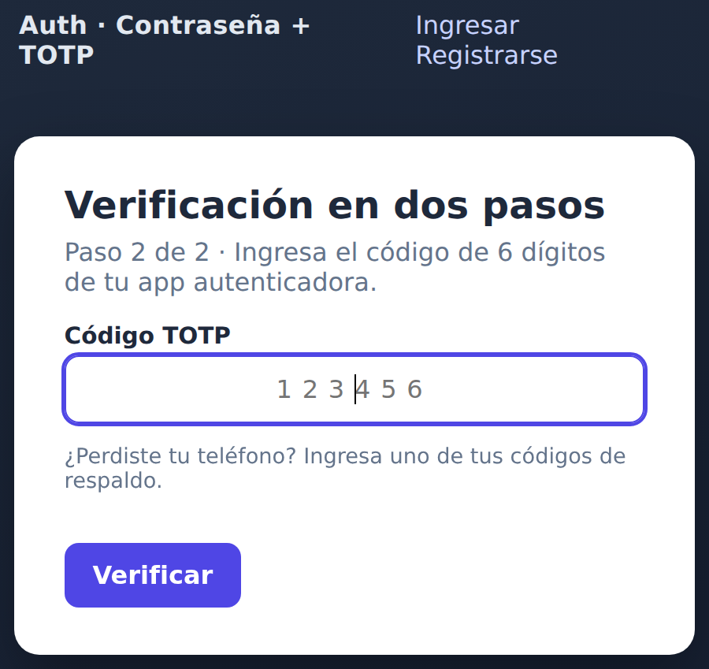
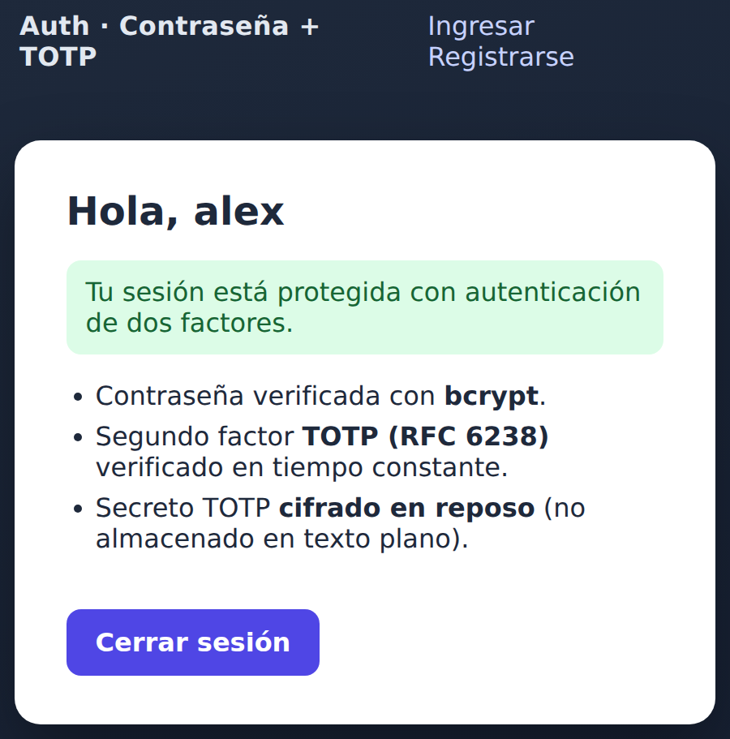
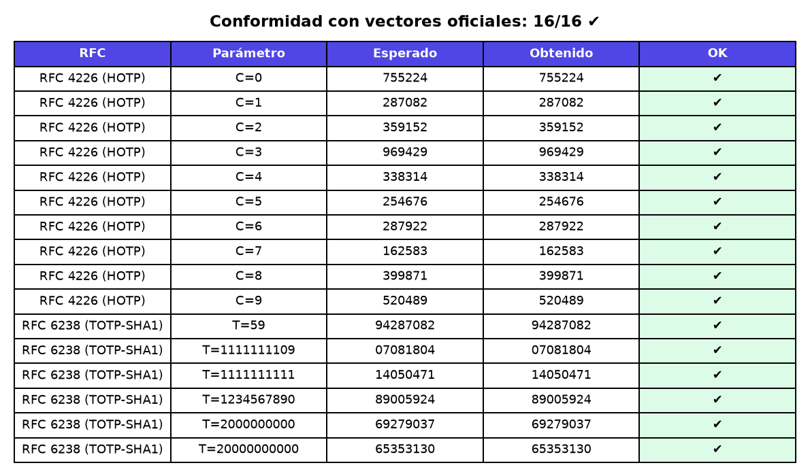
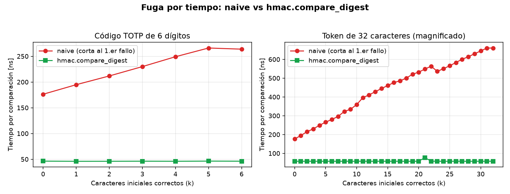
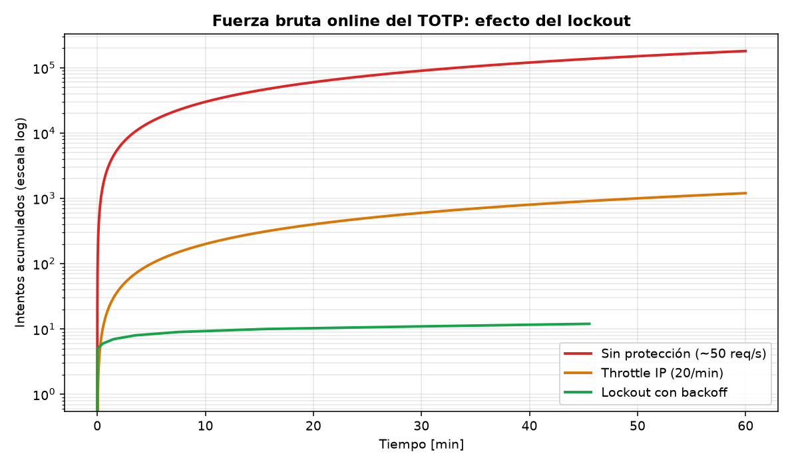

<!-- _class: lead -->

# Autenticación: contraseña + **TOTP**

## construida desde cero y **atacada por nosotros mismos**

**Miguel Ulloa Wood · Alexander Burgos Quezada**

IIC2531 — Seguridad Computacional · 2026

<!-- Hola, somos Miguel y Alexander. Nuestro proyecto es un sistema de autenticación de dos factores. La idea central: no solo construirlo, sino tratarlo como objeto de estudio de seguridad y medir si sus defensas realmente funcionan. -->

---

## El problema

- Las **contraseñas solas** son un factor débil: se reutilizan, se filtran, se phishean.
- **2FA**: aunque roben la contraseña, falta el segundo factor.
- **TOTP** es el 2FA más usado: solo un secreto + un reloj.
- Pero **implementarlo bien es sutil**: un detalle mal hecho rompe la garantía.

Implementamos un servidor web local que exige **contraseña + un código de 6 dígitos que cambia cada 30 s (TOTP)**. Lo distintivo: el algoritmo TOTP está implementado desde cero (no con una librería) y mediante IA atacamos a nuestro propio sistema y lo registramos.

<!-- Las contraseñas se filtran en brechas masivas y se reutilizan. El segundo factor mitiga esto. TOTP domina porque no necesita SMS ni hardware. El mensaje clave de la charla: que "funcione" no basta; los detalles deciden si resiste un ataque. -->

---

## Qué construimos (alcance)

- Servidor **Flask local** con login en **dos pasos**: contraseña + TOTP.
- **TOTP desde cero** (HMAC-SHA1, RFC 6238) — opera con Google/Microsoft Authenticator.
- Enrolamiento por **QR**, **códigos de respaldo**, panel.
- **Defensas**: cifrado del secreto, `compare_digest`, lockout, anti-replay, CSRF.
- **IA que simula un atacante**, ataca y mide nuestras propias defensas.



<!-- Construimos un servidor Flask con login en dos pasos. El núcleo TOTP está hecho a mano con la librería estándar para controlar cada paso. Lo novedoso, y lo que más pesa en un curso de seguridad, es el arnés que ataca nuestra propia implementación. -->

---

## Conexión con el curso

| Tema                   | Dónde aparece                                                                     |
| ---------------------- | --------------------------------------------------------------------------------- |
| Criptografía aplicada  | HMAC, bcrypt, cifrado autenticado                                                 |
| Autenticación          | login en dos pasos                                                                |
| Modelo de amenaza      | qué ataques estan dentro o fuera de alcance                                       |
| Canal lateral (timing) | `compare_digest`, segun la documentación, es la proteccion adecuada               |
| Defensa en profundidad | bloqueos de cuenta + limitar request por IP + seguridad contra replay             |
| Seguridad web          | Tokens CSRF, sesión, Protección contra inyeccion SQL por consultas parametrizadas |

<!-- El proyecto toca de forma transversal los temas del curso. No es solo cripto: es modelo de amenaza, canales laterales, defensa en profundidad y seguridad web. -->

---

## Modelo de amenaza



<!-- Definimos explícitamente el atacante: remoto, sin credenciales, que adivina, mide tiempos, reenvía peticiones y puede obtener una copia de la base de datos. A la izquierda lo mitigado; a la derecha el riesgo residual que dejamos fuera de alcance y que discutiremos al final. -->

---

## Arquitectura



<!-- Módulos con responsabilidades acotadas (privilegio mínimo y separación). `app.py` casi no piensa: recibe el HTTP y delega en `auth/accounts.py`, que coordina TOTP, crypto, rate-limiter y sesiones; la base de datos guarda hashes y el secreto cifrado. -->

---

<!-- _class: lead -->

# Fundamentos

## el algoritmo y el flujo, **en el código**

<!-- Tres láminas para mostrar el corazón del proyecto: cómo se genera un código TOTP, cómo lo implementamos desde cero, y cómo viaja una petición de login por el código. -->

---

## Cómo funciona TOTP



- `T = ⌊unix/30⌋` → `HMAC-SHA1(secreto, T)` → truncación dinámica → `mod 10⁶`
- El mismo secreto en el teléfono y en el servidor ⇒ mismo código.

<!-- TOTP es HOTP aplicado al tiempo. Se hace HMAC del secreto con el número de paso de 30 segundos, se trunca dinámicamente según el RFC 4226 y se toma módulo un millón. Como teléfono y servidor comparten secreto y reloj, generan el mismo código. -->

---

## El núcleo: TOTP desde cero — `auth/totp.py`

```python
def hotp(secret, counter, digits=6):            # RFC 4226
    msg = struct.pack(">Q", counter)            # contador → 8 bytes
    mac = hmac.new(secret, msg, hashlib.sha1).digest()
    off = mac[-1] & 0x0F                         # truncación dinámica
    code = ((mac[off]   & 0x7F) << 24 | (mac[off+1] & 0xFF) << 16
          | (mac[off+2] & 0xFF) << 8  |  mac[off+3] & 0xFF)
    return str(code % 10**digits).zfill(digits)

# TOTP = HOTP con contador = ⌊unix / 30⌋
def verify(secret, code, window=1):             # RFC 6238 · ±1 paso
    base, matched = int(time.time() // 30), None
    for off in range(-window, window + 1):      # recorre TODA la ventana
        if hmac.compare_digest(hotp(secret, base + off), code):
            matched = base + off                # sin cortar ⇒ tiempo constante
    return matched                              # paso usado ⇒ anti-replay
```

<!-- Este es el corazón: solo librería estándar. hotp hace el HMAC, la truncación dinámica del RFC y el módulo. verify recorre la ventana ±1 SIN cortar al primer acierto (tiempo constante), compara con compare_digest y DEVUELVE el paso que coincidió: ese número es justo lo que usa el anti-replay. Cada detalle —no cortar, compare_digest, devolver el contador— es una decisión de seguridad, no un capricho. -->

---

## Login en dos pasos



Estado intermedio **en el servidor** (_"pendiente de 2FA"_); solo el TOTP autentica y **regenera** la sesión (anti-fijación).

<!-- El estado intermedio vive en el servidor: nunca se confía en que el cliente diga "ya pasé la contraseña". Solo al validar el TOTP se promueve a autenticada, regenerando la sesión. La verificación del código incluye ventana ±1, anti-replay y comparación en tiempo constante. -->

---

<!-- _class: dense -->

## El flujo, en el código

`app.py` casi no piensa: recibe el HTTP y **delega** en `auth/accounts.py`. Una petición de **`POST /login`** (tras el guardia `csrf_protect`, un `before_request`):

1. **`verify_password_step`** — usuario inexistente ⇒ `dummy_verify` + mensaje genérico (**anti-enumeración**); chequea **lockout**; `verify_password` (bcrypt).
2. OK ⇒ **`start_pending_2fa`**: sesión _"pendiente de 2FA"_ → `/2fa`. **Aún no autenticado.**
3. **`verify_totp_step`** — `SecretVault` descifra el secreto → `totp.verify` (±1) → **anti-replay** (paso > último); o un **código de respaldo**.
4. OK ⇒ **`complete_login`**: **regenera** la sesión y recién fija `user_id` (**anti-fijación**).

**Registro:** `register` → `start_enrollment` (genera y **cifra** el secreto) → `confirm_enrollment` (primer código → activa el 2FA + códigos de respaldo).

<!-- app.py casi no piensa: delega en accounts. La traza muestra dónde vive cada defensa: anti-enumeración, lockout, anti-replay y anti-fijación están repartidas en módulos con responsabilidad acotada. El registro sigue la misma lógica, pero el secreto se CIFRA (no se hashea), porque para verificar hay que recalcular el HMAC. -->

---

## Decisiones de seguridad

| Riesgo                          | Defensa                                                   |
| ------------------------------- | --------------------------------------------------------- |
| Fuga del archivo `.db`          | bcrypt (contraseña) + secreto cifrado con AES y Hmac      |
| Fuerza bruta                    | Bloquear cuenta por intentos fallidos + limitación por IP |
| Ataques de timing               | `hmac.compare_digest`                                     |
| Replay de código                | último paso consumido                                     |
| Enumeración de usuarios         | mensaje uniforme + bcrypt señuelo si no existe usuario    |
| CSRF / Inyección SQL / fijación | token CSRF · queries parametrizadas · regen. sesión       |

<!-- Esta tabla es el corazón técnico: cada fila es una amenaza concreta con su defensa, las mismas que acabamos de ver en el código. En las próximas láminas mostramos evidencia medida de las cuatro más interesantes. -->

---

## Demo

  

_Enrolamiento (QR) → verificación 2FA → sesión protegida_

<!-- Demostración: el usuario escanea el QR, la app genera códigos, ingresa el de 6 dígitos y entra. Si hay tiempo lo mostramos en vivo en localhost:5000. -->

---

## Resultado E1 — Conformidad RFC



**16/16** vectores oficiales (RFC 4226 + RFC 6238) ⇒ correcto e **interoperable**.

<!-- Validamos contra los vectores de prueba oficiales de los RFC. 16 de 16 correctos. Esto prueba que el algoritmo es correcto y, por construcción, interoperable con cualquier app estándar. -->

---

## Resultado E3 — Canal lateral por tiempo



Comparación ingenua: **+16 ns/carácter** correcto (fuga). `compare_digest`: **plana**.

<!-- Medimos el tiempo de comparación según cuántos caracteres iniciales aciertan. La comparación ingenua sube linealmente: esa pendiente es la fuga que permite adivinar carácter a carácter. compare_digest es plana. Honestidad: amplificamos con un token de 32 caracteres para verlo; el principio vale igual. -->

---

## Resultado E4 — Fuerza bruta vs. lockout

| Escenario      | Intentos/h |  Tiempo a 50% |
| -------------- | ---------: | ------------: |
| Sin protección |    180.000 |     ~0,1 días |
| Throttle IP    |      1.200 |       ~8 días |
| **Lockout**    |     **12** | **~802 días** |



<!-- Un código de 6 dígitos tiene un millón de valores. Lo decisivo es cuántos intentos por hora se permiten. El lockout baja de 180 mil a 12 intentos por hora: el tiempo esperado de un ataque exitoso pasa de horas a más de dos años. Cuatro órdenes de magnitud. -->

---

## Resultado E5 + E6

**E5 — Replay**

```
[1] login con código 495104  -> ok
[2] MISMO código (misma ventana) -> RECHAZADO (replay)
```

**E6 — Pruebas:** `33 passed` (vectores RFC, lockout, replay, backup, cifrado, CSRF…)

<!-- El replay: un código vale una vez; reusarlo en su ventana se rechaza por el registro del último paso consumido. Y las 33 pruebas automatizadas pasan, cubriendo desde los vectores RFC hasta CSRF. -->

---

## Limitaciones y riesgo residual

- **TOTP es phishable**: Por naturaleza.
- **El primer mensaje es interceptable**: Un MitM puede interceptar en el enroll. Vulnerabilidad natural de TOTP.
- **Sin HTTPS** en demo local;(un proceso).
- **Ignoramos ataques de frontend**, no usamos un framework por simplicidad, y porque nuestro proyecto era de backend (el frontend es para testear).
- **Ataques distribuidos**: Restringimos requests por IP, ademas el bloqueo es por cada cuenta
- Ninguna 2FA protege un **endpoint comprometido**.

<!-- Somos honestos sobre los límites. TOTP no resiste phishing en tiempo real; la defensa real es WebAuthn. La seguridad del secreto cifrado depende de proteger la clave maestra. Y nada protege un dispositivo con malware. -->

---

## Aprendizajes

Como funciona algoritmo TOTP por detrás.

Implementacion de defensas contra ataques generales: Fuerza bruta (Limitacion por IP y bloqueo de cuenta), consultas parametrizadas para inyección SQL, tokens CSRF, proteccion contra replay.

Defensas específicas de TOTP: comparación en tiempo constante, cifrado del secreto, anti-replay.

Implementación de servidor web en Flask, y uso de SQLite.

<!-- El gran aprendizaje: la dificultad está en los detalles que deciden si resiste un ataque. Distinguir hashing de cifrado. Y sobre todo, que medir una defensa es muy distinto de suponer que funciona. -->

---

## Declaración de uso de IA

Usamos asistencia de IA (**Claude**) como apoyo en:

- **Redacción y estructura** de estas diapositivas y del guion. Posteriormente modificamos las slides. Y no seguimos el guion, sino que lo utilizamos como resumen impreso.
- **Realización de los scripts de ataque** (`attacks/`) y sus mediciones.

El resto del codigo, contenido técnico, las decisiones de seguridad y la verificación de los resultados fueron de parte nuestra.

<!-- Declaramos el uso de IA de forma explícita: nos apoyó en redactar y estructurar las láminas y el guion, y en el andamiaje de los scripts de ataque. La lógica de seguridad y la validación de los resultados son responsabilidad nuestra. -->

---

<!-- _class: lead -->

# ¿Preguntas?

**Gracias.**

_Código, informe y experimentos reproducibles con_ `make all`

<!-- Gracias. Todo es reproducible con make all. Quedamos atentos a sus preguntas. -->
